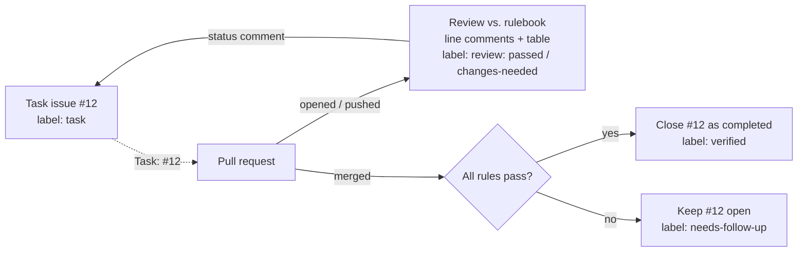
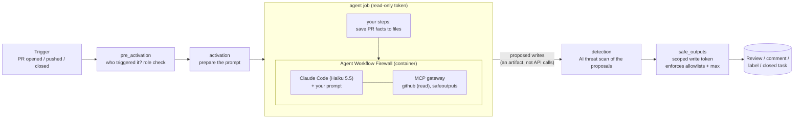

# GitHub Agentic Workflows (gh-aw)

GitHub Agentic Workflows let you write a GitHub Actions automation **in Markdown**: a YAML
header that says *when it runs and what it may touch*, and a plain-English body that says
*what to do*. An AI coding agent (in this lab, Claude Code running Claude Haiku 5.5) does the work
inside a locked-down sandbox, and only the write actions you allowlisted ever reach your repository.

> Think of it as **"CI for judgment calls"**. Plain Actions run the steps you scripted. Agentic
> workflows handle the jobs you could never script: "what does this PR actually change?",
> "does it follow our team's rules?", "is this task really done, or just merged?"

The student handout is [`docs/labs/lab07_github_agentic_workflows.md`](../docs/labs/lab07_github_agentic_workflows.md).
This folder holds the supporting material.

| Path | What it is |
|---|---|
| [`scripts/setup-windows.ps1`](scripts/setup-windows.ps1), [`scripts/setup.sh`](scripts/setup.sh) | Install and verify `gh` and the `gh aw` extension |
| [`redteam/`](redteam) | Four pull requests that try to trick the code reviewer (Lab 7 §8) |
| [`starter/rule-template.md`](starter/rule-template.md) | How to write a good review rule, for the graded exercise (Lab 7 §9) |

### The two lab examples

Both live where GitHub needs them, in [`.github/workflows/`](../.github/workflows):

| Example | Trigger | Allowed writes | What it teaches |
|---|---|---|---|
| **1.** [`fis-pr-summary`](../.github/workflows/fis-pr-summary.md): PR explainer | PR opened or reopened | 1 comment, posted live (students then try **staged** preview mode) | Anatomy of a workflow, compile, lock files, staged mode |
| **2.** [`fis-code-review`](../.github/workflows/fis-code-review.md): code reviewer and task tracker | PR opened, pushed to, or closed, touching `services/frontend/` or `services/backend/` | 1 review (comment or request changes, **never approve**), up to 5 line comments, 4 status labels, 1 task comment, close 1 issue **only if labelled `task`** | Rules as data, PR reviews, linking work to tasks, tight write limits |

Example 2 checks the human-written rulebook [`.github/review-rules.md`](../.github/review-rules.md).
Tasks are issues created from the **Task** issue template ([`.github/ISSUE_TEMPLATE/task.md`](../.github/ISSUE_TEMPLATE/task.md)),
which adds the `task` label. A PR links to one with `Task: #N` in its description (the PR template has the line).

---

## How a run works

`gh aw compile` turns each `name.md` into `name.lock.yml`, an ordinary (if long) GitHub Actions
workflow. GitHub runs the **lock file**. The Markdown is the source you edit. Commit both.

What makes it safe:

1. **The agent cannot write.** Its `GITHUB_TOKEN` has read scopes only. When it "closes a task" it
   is really calling a `safeoutputs` tool that records the request in a file.
2. **Writes happen in a different job.** `safe_outputs` re-checks every request against your
   frontmatter (allowed labels, `max`, allowed review types, `required-labels`, target) before
   calling the API. Anything off-list is dropped, whatever the model was talked into.
3. **The network is allowlisted.** The agent runs behind a Squid proxy. `network: allowed: []` means
   it can reach only the GitHub and model endpoints the framework needs.
4. **A separate threat-detection job** reviews the proposed outputs for leaked secrets or malicious
   content before anything is written. The prompts also tell the agent that PR text and code are data, not instructions.
5. **The compiler is strict by default.** It refuses write permissions on the agent job, wildcard network
   access, unpinned actions and unknown `${{ }}` expressions. Lab 7 §3.2 has students trigger two of these errors.

None of this is a proof of safety. Treat it as defence in depth, and keep the allowlists tight.

## gh-aw vs. the alternatives

| | Plain GitHub Actions | gh-aw agentic workflow | Copilot coding agent |
|---|---|---|---|
| You write | YAML steps | Markdown intent + YAML guardrails | An issue assigned to Copilot |
| Good for | Deterministic build/test/deploy | Triage, review, investigation, reports | Writing a feature or fix |
| Writes | Anything its token allows | Only allowlisted **safe outputs** | A PR you review |
| Runs | On events | On events, without supervision | When asked |
| Cost | Runner minutes | Runner minutes + AI credits (capped per run) | Copilot plan |

Rule of thumb from the gh-aw docs: **deterministic where you can, agentic where you must.** If a
`grep` can answer it, do not pay a model to answer it.

## Lab setup (instructor / repo owner)

1. Install the tools: run `scripts/setup-windows.ps1` (PowerShell) or `scripts/setup.sh` (macOS / Linux / WSL).
2. Sign in: `gh auth login --scopes repo,workflow`.
3. Create an **Anthropic API key** for the Claude engine:
   - Go to console.anthropic.com. Under **Billing**, add a few dollars of credit (pay-as-you-go,
     separate from any Claude.ai subscription). Under **API Keys**, create a key.
   - Store it as a repo secret: `gh aw secrets set ANTHROPIC_API_KEY`. Paste the key when prompted;
     it never touches a file. Every fork needs its own secret, because forks do not inherit secrets.
4. Check the setup: `gh aw secrets bootstrap --non-interactive` lists any secret that is still missing.
5. Set up the repository for gh-aw, from the repo root: `gh aw init --engine claude`. It marks lock
   files as generated in `.gitattributes` and adds the `agentic-workflows` skill (`.github/skills/`),
   which follows the house rules in `.github/aw/instructions.md`. (This repo also has
   `.github/agents/agentic-workflows.md` from an earlier `--engine copilot` init: an optional Copilot
   Chat helper for writing workflows in VS Code.)
6. Compile the two examples: `gh aw compile --strict`. This creates `fis-pr-summary.lock.yml` and
   `fis-code-review.lock.yml`, the files GitHub actually runs. It must finish with 0 errors and 0 warnings.
7. Commit everything `init` and `compile` produced together with the `.md` files, then merge. The
   helpers' instructions and the rulebook are always read from `main` (a pull request cannot rewrite its
   own reviewer), so they must be merged before any pull request can use them. Lock-file settings such as
   `steps:` and `staged` do apply from a PR's own branch.

Things to know for the shared course repository (students' own forks and team repos are unaffected):

- **Who triggers the reviewer.** Agentic workflows only run for users with admin, maintain or write
  access (the compiled check is `GH_AW_REQUIRED_ROLES: "admin,maintainer,write"`), and pull requests
  from **someone else's fork** are blocked by default. Lab 0's flow (branches inside your fork or team
  repo) is unaffected. Opening it wider (`roles: all`, `forks: [...]` under `on:`) exposes the agent to
  anyone's prompt injection, and spends AI credits on every push.
- **Cost.** Both helpers use Claude Haiku 5.5 (`claude-haiku-5-5`, $0.10 / $0.50 per million input /
  output tokens). Measured runs cost about 1 AI credit (≈ $0.01) each, billed to the Anthropic account
  behind `ANTHROPIC_API_KEY`. The reviewer runs on every push to a frontend/backend PR, capped at 200 AI
  credits ($2) per run; the explainer runs once per PR, capped at 80. Check real spend with `gh aw logs`
  and `gh aw forecast`.

Switching engines or models is a frontmatter change: edit the `engine:` block (for example
`model: claude-sonnet-5-5` for a more capable reviewer, or `id: copilot` with a `COPILOT_GITHUB_TOKEN`
secret), then recompile. `gh aw models` lists model IDs and prices.

## References

- Docs: <https://github.github.com/gh-aw/>, especially the [quick start](https://github.github.com/gh-aw/setup/quick-start/), [frontmatter](https://github.github.com/gh-aw/reference/frontmatter/), [safe outputs](https://github.github.com/gh-aw/reference/safe-outputs/) and [security architecture](https://github.github.com/gh-aw/introduction/architecture/)
- Source and CLI: <https://github.com/github/gh-aw>
- Sample library: <https://github.com/githubnext/agentics>. Add one with `gh aw add githubnext/agentics/<name>`
- Built with `gh aw` **v1.2.2**. Check yours with `gh aw version`.
