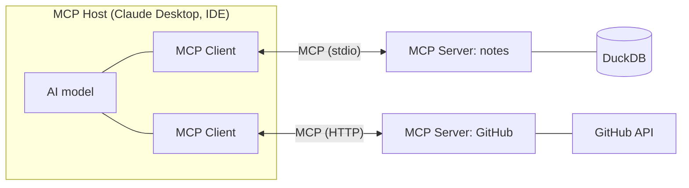
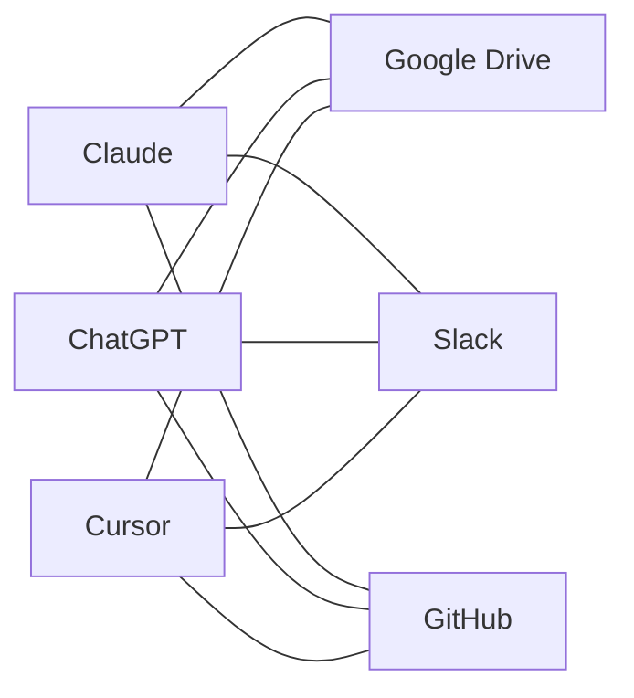
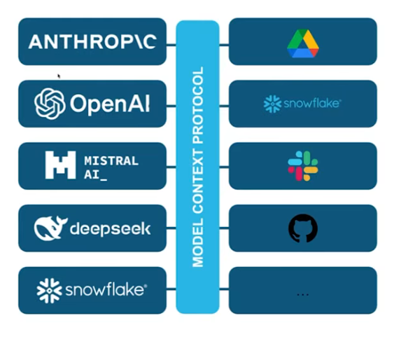

# MCP — Model Context Protocol

MCP (Model Context Protocol) is an open protocol, introduced by Anthropic, that defines how AI applications (like Claude) connect to external tools, data sources and services.

> Think of MCP like **USB-C for AI**. USB-C lets any device connect to any peripheral; MCP lets any AI app connect to any tool or data source in a standard way.

MCP makes AI agents useful by giving them **structured, secure and standardized access to the real world**.

## Three main components

| Component  | Role                                                                |
|------------|---------------------------------------------------------------------|
| MCP Host   | The AI app the user works in (e.g. Claude Desktop, an IDE)          |
| MCP Client | Built into the host; holds one connection to one MCP server         |
| MCP Server | Exposes tools and data from a service (e.g. GitHub, Slack, Snowflake) |

## Architecture

*The host runs one client per server. Each server wraps a data source or service and exposes it as tools.*

## Why MCP?

Before MCP, integrating AI with external tools was fragmented:

- Every tool needed a **custom integration**
- There was no standard for **authentication or permissions**
- Integrations were hard to **scale or reuse** across AI apps
- It created an **M×N problem**: M AI apps × N tools = M×N custom connectors

**Without MCP: M×N custom connectors**

**With MCP: M+N**

MCP replaces this with **one universal protocol**, reducing the work to M+N:

- Each of the M AI apps implements the MCP **client** once
- Each of the N tools implements the MCP **server** once

## References

- [Snowflake-Labs MCP server guide](https://github.com/Snowflake-Labs/sfguide-getting-started-with-snowflake-mcp-server)
- [MCP servers listing](https://github.com/modelcontextprotocol/servers)
- [Anthropic MCP announcement](https://www.anthropic.com/news/model-context-protocol)
